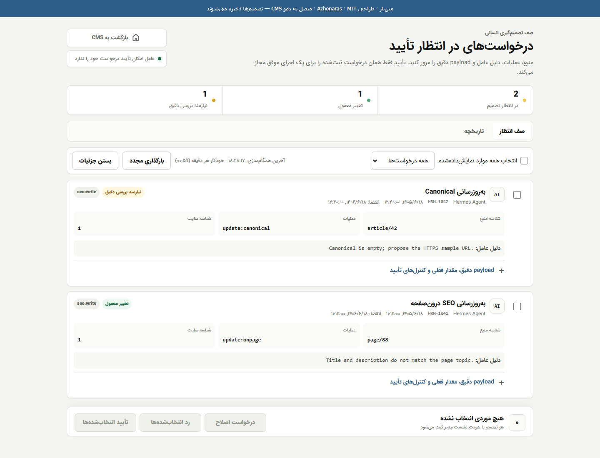
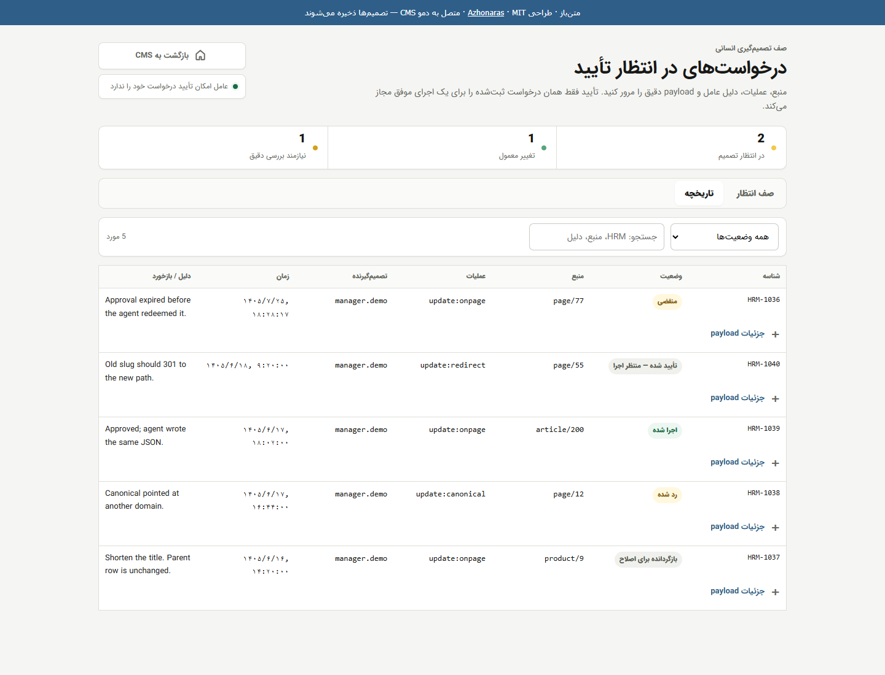
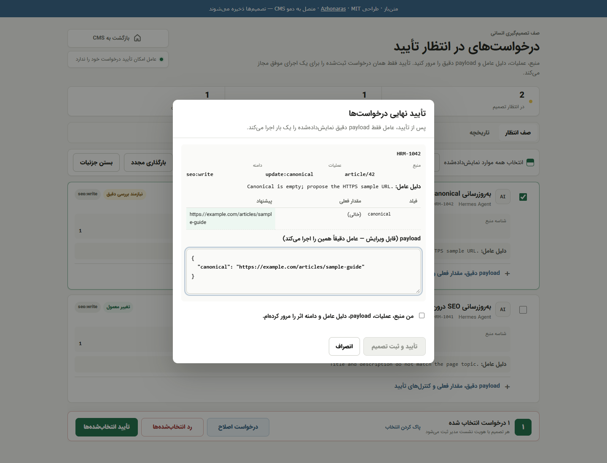
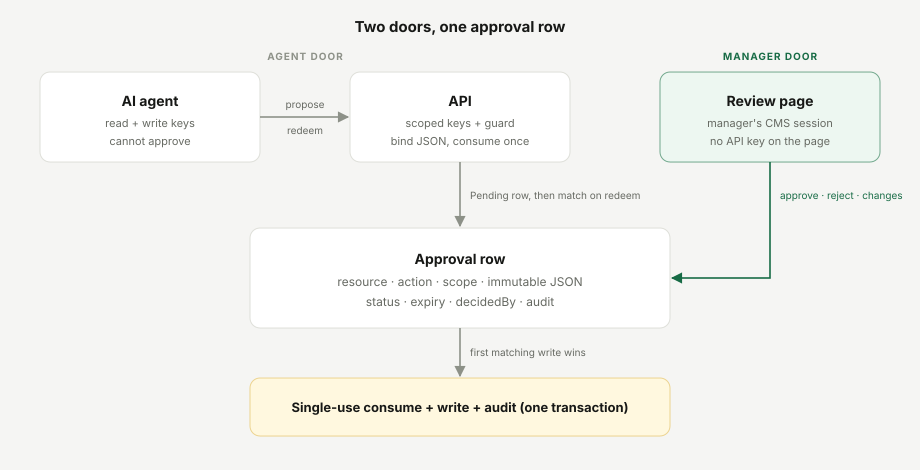
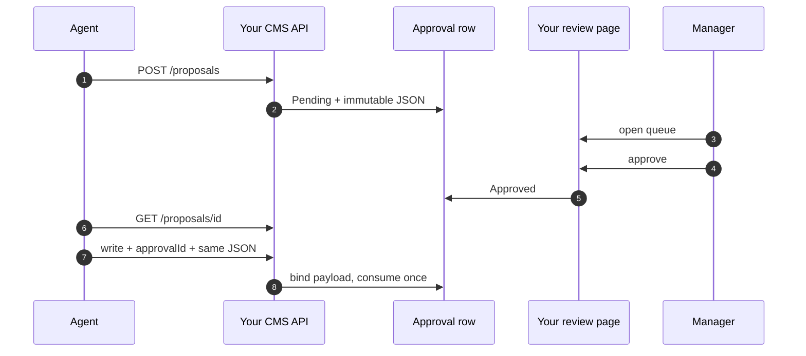
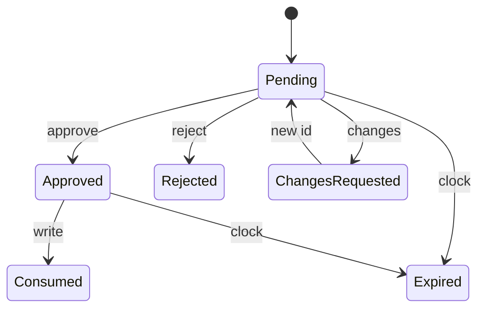

# Website Agent Connector

<div dir="rtl">

**فارسی** | [English](README.md) · [](LICENSE)

صف تأیید انسانی بین ایجنت (agent) هوش مصنوعی و سی‌ام‌اس (CMS) وب‌سایت شما.

یک ایجنت به سبک هرمس (Hermes) را به هر سی‌ام‌اسی که در اختیار دارید متصل کنید. روند کار بدین صورت است: ایجنت تغییری را پیشنهاد می‌دهد، یکی از مدیران سایت پیلود (payload) دقیق ارسالی را بررسی و دربارۀ آن تصمیم می‌گیرد، و ایجنت هرگز نمی‌تواند تغییرات خود را تأیید کند.

این رپو (repo) شامل یک قرارداد فنی (contract)، یک کلاینت، یک دموی سی‌ام‌اس و یک رابط کاربری بازبینی (review UI) است. این پروژه یک سرویس میزبانی‌شده (hosted) نیست و به هیچ وب‌سایت شخص ثالثی متصل نمی‌شود.

صحت این سازوکار به شکل محلی روی یک استک (stack) واقعی ASP.NET WebForms (شامل Web API و نشست مدیریتی) تست و تأیید شده است: خواندن، نوشتن، تأیید انسانی، و یک پیلود منطبق. آن وب‌سایت در این رپو منتشر نشده است، اما هر استک دیگری می‌تواند دقیقاً همین درگاه‌ها (doors) را پیاده‌سازی کند.

**[دموی رابط بازبینی](demo/index.html)** · [اتصال سی‌ام‌اس شما](docs/connect-your-cms.md) · [مشخصات فنی (Spec)](docs/spec.md) · [معماری](docs/architecture.md) · [امنیت](docs/security.md)



<details>
<summary>تاریخچه</summary>

</details>

<details>
<summary>پنجرۀ تأیید نهایی</summary>

</details>

## ساختار رپو

| مسیر | کاربرد |
| --- | --- |
| [`src/`](src/README.md) | کدهای اصلی: کلاینت ایجنت، رسیور سمت ایجنت برای دریافت اعلان‌های تصمیم‌گیری، و یک سرور ماژولار Node (قوانین محوری، لایۀ ذخیره‌سازی، آداپتور سی‌ام‌اس، و HTTP) |
| [`docs/spec.md`](docs/spec.md) | قراردادی که سی‌ام‌اس شما باید پیاده‌سازی کند |
| [`examples/`](examples/) | حلقۀ ایجنت، ایجنتی که پس از ثبت تصمیم مطلع می‌شود (`agent-webhook.mjs`)، و بستر آزمون دو‌درگاهه |
| [`demo-cms/`](demo-cms/) | دموی سی‌ام‌اس محلی: اتصال `src/server` به داده‌های درون‌حافظه‌ای (کلیدهای تستی، نشانی `127.0.0.1`) |
| [`demo/`](demo/) | رابط کاربری بازبینی (ماژول‌های سبک ES در مسیر `demo/js/`) |
| [`conformance/`](conformance/README.md) | مجموعۀ آزمون‌های انطباق (conformance suite) مستقل از استک. کافی است آن را به آدرس هر سی‌ام‌اسی وصل کنید تا رعایت قرارداد بررسی شود |
| [`ports/`](ports/README.md) | پیاده‌سازی همین قرارداد روی سایر استک‌ها: .NET 8 به همراه SQL Server، هستۀ مستقل PHP بدون فریم‌ورک، و پلاگین وردپرس |
| [`test/`](test/) | آزمون‌های واحد (unit tests) برای قواعد، سرویس و توابع کمکی رابط کاربری؛ همراه با تست‌های سرتاسری (end-to-end) پروتکل HTTP |

## تست‌شده روی استک‌های واقعی

اعتبار قرارداد تنها زمانی ثابت می‌شود که سایر استک‌ها هم بتوانند آن را پیاده‌سازی کنند. به همین جهت، همان مجموعۀ آزمون جعبۀ سیاه (black-box suite) ([۸۴ بررسی انطباق](conformance/README.md) که ۹ مورد آن برای اعلان‌های تصمیم اختیاری است) روی هر پیاده‌سازی در کنار یک دیتابیس واقعی اجرا می‌شود. یک کاوشگر تطبیقی (differential probe) همان ۹۸ درخواست مخرب (hostile requests) را به همۀ پیاده‌سازی‌ها ارسال می‌کند، و یک فازر (fuzzer) هزاران درخواست تولیدشدۀ خودکار می‌فرستد (۱۵٬۰۰۰ درخواست در هر اجرا با سه دانۀ اولیه یا seed). هرگونه مغایرت نشان‌دهندۀ وجود باگ در یکی از این پیاده‌سازی‌ها است.

| استک | دیتابیس | مجموعۀ آزمون | آزمون تطبیقی (Differential) |
| --- | --- | --- | --- |
| مرجع Node (`src/server`، `demo-cms`) | در حافظه (memory) | قبولی (pass)، به همراه اعلان‌ها (۱ هشدار CORS مختص نسخۀ دمو) | ۰ عدم تطابق، ۰ مغایرت در فازر |
| [.NET 8 / ASP.NET Core](ports/dotnet/README.md) | SQL Server 2022 | ۸۴ از ۸۴ روی هاست درون‌حافظه‌ای (`ports/dotnet.tests/MemoryHost`)؛ ذخیره‌ساز SQL Server در همۀ بررسی‌ها به جز اعلان تصمیم (که هنوز روی آن اجرا نشده) قبول می‌شود | ۰ عدم تطابق، ۰ مغایرت در فازر |
| [پلاگین WordPress 7.1](ports/php/wordpress/README.md) پشت `php -S` | MariaDB 10.11 (InnoDB) | ۸۳ از ۸۴ به‌علاوۀ ۱ هشدار (سرور داخلی `php -S` نمی‌تواند پیش از ارسال اعلان به بازبین پاسخ دهد، در نتیجه بازبین منتظر رسیور می‌ماند؛ این نقص پلاگین نیست)، همراه با ۱۶ سناریوی اختصاصی وردپرس و اجرای مرورگر در wp-admin | ۰ عدم تطابق، ۰ مغایرت در فازر |
| پلاگین WordPress 7.1 پشت nginx + PHP-FPM (ساختار استاندارد اغلب سایت‌های وردپرسی) | MariaDB 10.11 (InnoDB) | ۸۴ از ۸۴ | ۰ عدم تطابق، ۰ مغایرت در فازر (۱۰٬۰۰۰ تست در مقایسه با سه استک دیگر) |
| پلاگین WordPress 7.1 روی PHP 8.3 | SQLite (افزونۀ SQLite Database Integration 3.0.2) | قبولی، همراه با ۱۱ مورد از سناریوهای اختصاصی وردپرس (آزمون اعلان تصمیم هنوز روی این محیط اجرا نشده است) | ۰ عدم تطابق، ۰ مغایرت در فازر |
| پلاگین WordPress 7.1 روی [WordPress Playground](ports/php/wordpress/README.md#try-it-on-wordpress-playground-sqlite) | SQLite، زبان PHP کامپایل‌شده به وب‌اسمبلی | ۷۰ از ۷۵، به‌علاوۀ ۲ هشدار: ۳ مورد عدم قبولی مربوط به خطای `500` سرور توسعۀ Playground در مواجهه با دنبالۀ درصدیِ نامعتبر (malformed `%` escape) است. ۹ بررسی اعلان تصمیم هنوز روی Playground آزمایش نشده است | در همان ۳ مورد تفاوت دارد |
| Symfony, Ruby on Rails | | هنوز پیاده‌سازی نشده است | |

وب‌سرورهای nginx و Apache دنبالۀ درصدیِ نامعتبر (مانند `/%zz`) را پیش از رسیدن به وردپرس، با خطای `400` اختصاصی خود مسدود می‌کنند. مجموعۀ آزمون، کاوشگر تطبیقی و فازر این حالت را از سی‌ام‌اسی که مسیر را پیش از بررسی درگاه ورودی می‌خواند تفکیک می‌کنند ([نحوۀ تشخیص](conformance/README.md#what-it-checks)) و این موضوع را صریحاً در خروجی اعلام می‌نمایند.

## تفکیک وظایف پیاده‌سازی

| سمت | موارد برداشته‌شده از این رپو | مواردی که خودتان فراهم می‌کنید |
| --- | --- | --- |
| هرمس (یا هر ایجنت دیگر) | [`src/client.js`](src/client.js)، [حلقۀ ایجنت](examples/agent-loop.mjs) | کلید نوشتن (write key)؛ بدون دسترسی به درگاه بازبینی |
| سی‌ام‌اس شما | [spec](docs/spec.md)، ماشین حالت (state machine)، محافظ (guard)، قوانین رابط کاربری | سامانۀ لاگین، نقش‌های کاربری (roles)، عملیات نوشتن واقعی، صفحات اختصاصی شما |

## اجرای پروژه

تنها پیش‌نیاز شما Node.js نسخۀ ۱۸ یا جدیدتر است و به هیچ چیز دیگری نیاز ندارید: بدون نیاز به `npm install` و بدون دیتابیس. دموی سی‌ام‌اس داده‌ها را در حافظه نگه می‌دارد و با هر بار راه‌اندازی از نو آغاز به کار می‌کند. این مراحل برای ویندوز (PowerShell) تدوین شده است؛ در macOS یا لینوکس نیز همین دستورها دقیقاً یکسان هستند.

0. دریافت کد: رپو را با دستور `git clone` کلون کنید (یا فایل ZIP را دانلود نمایید) و ترمینال را در پوشۀ آن باز کنید.
1. نصب Node.js: نسخۀ LTS را با دستور `winget install OpenJS.NodeJS.LTS` یا از طریق نصب‌کنندۀ وب‌سایت [nodejs.org](https://nodejs.org) نصب کنید. سپس یک پنجرۀ تازۀ PowerShell باز کنید تا دستورهای `node` و `npm` در دسترس باشند. اگر با پیام خطای غیرفعال بودن اجرای اسکریپت‌ها در PowerShell مواجه شدید، هر جا که `npm` آمده از `npm.cmd` استفاده کنید یا ترمینال Command Prompt را به کار ببرید.
2. اجرای دموی سی‌ام‌اس: دستورهای زیر را اجرا کنید و این پنجره را باز بگذارید (توقف با کلیدهای Ctrl+C):

<div dir="ltr">

```powershell
cd website-agent-connector
npm start
```

</div>

3. باز کردن صفحۀ بازبینی: به نشانی <http://127.0.0.1:8790/demo/> بروید. با برقراری اتصال با API، عبارت «متصل به دمو CMS» در بالای صفحه ظاهر می‌شود. اگر سطرهای نمونه و عبارت «برای اتصال به API» را دیدید، یعنی سرور در حال اجرا نیست.
4. اجرای ایجنت در پنجرۀ دوم: در پنجرۀ دوم PowerShell ایجنت را اجرا کنید. ایجنت تغییری ثبت می‌کند، عبارت `submitted HRM-<id> Pending` را لاگ می‌زند و تا حداکثر ۱۰ دقیقه منتظر تصمیم‌گیری کاربر انسانی می‌ماند:

<div dir="ltr">

```powershell
cd website-agent-connector
npm run agent
```

</div>

5. تأیید درخواست در نقش مدیر: در صفحۀ بازبینی دکمۀ «بارگذاری مجدد» را بزنید (یا منتظر تازه‌سازی خودکار در هر دقیقه بمانید)، تیک درخواست جدید را بزنید، دکمۀ «تأیید انتخاب‌شده‌ها» را بفشارید، جدول مقایسۀ وضعیت قبل و بعد را بررسی کنید، کادر تأیید را علامت بزنید و دکمۀ «تأیید و ثبت تصمیم» را انتخاب نمایید. پنجرۀ ایجنت عبارت `executed` را چاپ کرده و خارج می‌شود. همچنین می‌توانید پیش از تأیید، محتوای JSON را ویرایش کنید؛ در این حالت ایجنت ملزم است دقیقاً همان نسخۀ ویرایش‌شدۀ شما را اجرا کند. چنانچه مهلت انتظار ایجنت به پایان رسید، با دستور `$env:APPROVAL_ID=<id>; npm run agent` ادامۀ اجرای آن را پی بگیرید (و پیش از ارسال درخواست تازه، متغیر محیطی را با `Remove-Item Env:APPROVAL_ID` پاک کنید).
6. اجرای آزمون‌ها: آزمون‌های واحد و سرتاسری روی پورت‌های مستقل اجرا می‌شوند، بنابراین نسخۀ دمو می‌تواند بدون وقفه به کار خود ادامه دهد. مجموعۀ آزمون‌های انطباق صحت دموی فعال را بررسی می‌نماید:

<div dir="ltr">

```powershell
npm test
npm run conformance
```

</div>

| عنوان | نشانی / دستور |
| --- | --- |
| صفحۀ بازبینی | <http://127.0.0.1:8790/demo/> |
| کلیدهای دسترسی ایجنت | `demo-read`، `demo-write` (هیچ‌کدام مجاز به تأیید نیستند) |
| نشست بازبینی (صرفاً در نسخۀ دمو) | `X-Review-Session: demo-manager` |
| اجرای چرخۀ کامل بدون دخالت انسان | `npm run loop` (بستر آزمایشی که خودکار تأیید را انجام می‌دهد) |
| ایجنتی که با اعلان مطلع می‌شود (بدون استعلام دوره‌ای) | `npm run agent:webhook` (بخش [بدون استعلام دوره‌ای](#no-polling) را ببینید) |
| ایجنتی که پیوسته در حال اجرا می‌ماند و بر اساس تصمیم اقدام می‌کند | `npm run agent:standing` (بخش [اجرای پیوستۀ ایجنت](#standing-agent) را ببینید) |

در وردپرس، صفحۀ بازبینی داخل منوی مدیریت (wp-admin) قرار دارد. پلاگین را با دستور `node ports/php/wordpress/build.mjs` بسازید، پوشۀ `ports/php/wordpress/dist/hermes-approval` را به مسیر `wp-content/plugins/` انتقال دهید، آن را فعال کنید و گزینۀ Agent requests را در منوی ادمین باز نمایید. جزئیات پیکربندی و کلیدها در [فایل راهنمای پلاگین](ports/php/wordpress/README.md) آمده است.

## نحوۀ کارکرد

ایجنت و مدیر از طریق دو درگاه کاملاً مستقل وارد سامانه می‌شوند.

| مؤلفه | ایجنت | مدیر |
| --- | --- | --- |
| هویت و احراز دسترسی | کلیدهای API با دامنۀ دسترسی معین (خواندن و نوشتن) | نشست کاربریِ سی‌ام‌اس شما |
| اختیارات مجاز | خواندن داده‌ها، ارسال پیشنهاد، استعلام وضعیت (polling)، اجرای یک‌بارۀ نوشتنِ تأییدشده | تأیید یا Approve (اختیاراً پس از ویرایش پیلود)، رد درخواست (reject)، درخواست اصلاحات |
| موارد نامجاز | تأیید یا تغییر دادن بدنۀ بازبینی‌شده | در اختیار داشتن کلیدهای دسترسی ایجنت |

به محض آنکه درخواستی به وضعیت تأییدشده (Approved) برسد، ایجنت همان عملیات نوشتن را دقیقاً یک نوبت اجرا می‌کند. پیامی در چت هرگز به منزلۀ تأیید تلقی نمی‌شود.



<div dir="ltr">



</div>

[معماری](docs/architecture.md) · [اتصال سی‌ام‌اس شما](docs/connect-your-cms.md)

<a id="no-polling"></a>

## بدون استعلام دوره‌ای (Polling): اعلام تصمیم به ایجنت

ایجنت به‌طور پیش‌فرض با ارسال متناوب درخواست‌های `GET /proposals/{id}` در فواصل چند ثانیه‌ای از نتیجه باخبر می‌شود. با این حال، سی‌ام‌اس می‌تواند پس از هر بار تأیید، رد، یا درخواست اصلاحات، یک اعلان کوتاه به نشانی وب تنظیم‌شده توسط اپراتور سایت ارسال کند ([spec](docs/spec.md#decision-notifications-optional)):

<div dir="ltr">

```
POST https://agent.example/hooks/hermes
X-Hermes-Delivery: 5c0e...   X-Hermes-Timestamp: 1760580012   X-Hermes-Signature: sha256=8bd7...
{"event":"decision","approvalId":1042,"status":"Approved","decidedUtc":"2026-10-16T01:40:12.345Z"}
```

</div>

این اعلان فقط شامل شناسه (id) و وضعیت جدید است و هرگز متن پروپوزال یا دلیل تصمیم را حمل نمی‌کند. ایجنت همچنان سطر مربوطه را با کلید خودش می‌خواند و خودش آن را اجرا (redeem) می‌کند؛ بنابراین درگاه‌ها، وضعیت‌ها و محافظ نوشتن هیچ تغییری نمی‌کنند و یک اعلان ساختگی حداکثر می‌تواند منجر به ارسال یک درخواست اضافیِ `GET` از سوی ایجنت شود. نشانی گیرنده به اپراتور سایت تعلق دارد نه به ایجنت، چرا که در غیر این صورت ایجنت می‌توانست سامانه را به سوی هر آدرس دلخواهی هدایت کند. ارسال اعلان فقط یک نوبت انجام می‌شود، حداکثر ۳ ثانیه زمان می‌برد، تلاش مجدد (retry) ندارد و تغییر مسیرها (redirects) را دنبال نمی‌کند. از دسترس خارج بودن، کندی یا خطای گیرنده هرگز تغییری در تصمیم ثبت‌شده ایجاد نمی‌کند، از همین رو ایجنت یک استعلام دوره‌ای با فاصلۀ طولانی را به عنوان سازوکار پشتیبان (fallback) حفظ می‌کند.

<div dir="ltr">

```js
const { createReceiver } = require('./src/receiver.js');     // checks the signature and the clock for you
await createReceiver({ port: 8795, secret: process.env.WEBHOOK_SECRET, onDecision: ({ approvalId }) => agent.get(approvalId) });
```

</div>

برای تست این قابلیت، دمو را با متغیرهای `WEBHOOK_URL=http://127.0.0.1:8795/hook WEBHOOK_SECRET=demo-secret npm start` اجرا کنید، دستور `WEBHOOK_SECRET=demo-secret npm run agent:webhook` را بزنید و در صفحۀ بازبینی تأیید را انجام دهید؛ ایجنت بلافاصله فعال می‌شود. این قابلیت به شکل استاندارد در دموی Node، [پلاگین وردپرس](ports/php/wordpress/README.md#telling-the-agent-when-you-decide) و [پورت .NET](ports/dotnet/README.md) تعبیه شده است و یک گروه از آزمون‌های انطباق صحت آن را در هر استکی ارزیابی می‌کند.

<a id="standing-agent"></a>

### اجرای پیوستۀ ایجنتی که بر اساس تصمیم اقدام می‌کند

اعلان تا زمانی که سرویسی برای شنیدن و پردازش آن آماده نباشد اثری نخواهد داشت. ایجنتی که صرفاً در یک نشست گفتگو فعالیت دارد یا فرآیند انتظار را به یک پایشگر (watcher) مجزا می‌سپارد، ممکن است هنگام ثبت تصمیم توسط انسان در حالت غیرفعال باشد؛ در این حالت اعلان در کمتر از یک ثانیه می‌رسد اما عملیات نوشتن معطل فعال شدن مجدد ایجنت می‌ماند. راهکار بهینه، قرار دادن منطق اقدام مستقیماً درون خود رسیور است. فایل [`src/standing-agent.js`](src/standing-agent.js) دقیقاً این وظیفه را انجام می‌دهد: درخواست‌های ثبت‌شدۀ خود را به خاطر می‌سپارد، و به محض تأیید یکی از آن‌ها، سطر مربوطه را با کلید خودش می‌خواند و دقیقاً محتوای JSON تأییدشده (شامل ویرایش‌های اعمال‌شده توسط بازبین) را یک بار اجرا می‌کند. در صورت رد درخواست یا تقاضای ویرایش، موضوع تنها گزارش داده می‌شود. این سرویس تصمیم‌های مربوط به درخواست‌هایی را که خودش ثبت نکرده باشد نادیده می‌گیرد و هنگام راه‌اندازی و طبق یک زمان‌بندی منظم، تمام درخواست‌های باز را دوباره بررسی (sweep) می‌کند تا تصمیمی که در زمان خاموش بودن سرور گرفته شده نیز بازیابی شود.

<div dir="ltr">

```
BASE_URL=... WRITE_KEY=... WEBHOOK_SECRET=... STATE_FILE=standing-agent.json LOG_FILE=standing-agent.log \
  SUBMIT_FILE=requests.json npm run agent:standing        # or WATCH=14,15 for requests filed another way
```

</div>

## اصولی که بازبینی را واقعی می‌سازند

1. تأیید کردن منحصراً یک اقدام انسانی است؛ کلید نوشتن به تنهایی امکان تصمیم‌گیری ندارد.
2. بدنۀ درخواست مقید (bound) است؛ Resource، action، scope و JSON کانونیکال (canonical JSON) باید مو‌به‌مو با آنچه مدیر مشاهده و بازبینی کرده منطبق باشد.
3. هر مجوز تأیید فقط یک بار مصرف می‌شود؛ نخستین عملیات نوشتنِ معتبر، سطر مربوطه را مصرف می‌کند.
4. در صورت شکست عملیات نوشتن، تغییرات بازگردانده می‌شود (rollback) و وضعیت سطر دوباره به حالت تأییدشده (Approved) برمی‌گردد.
5. بازنگری‌ها شناسه‌های تازه‌ای دریافت می‌کنند؛ درخواست اصلاحات تغییری در سطر والد به وجود نمی‌آورد.
6. عملیات خواندن نیازی به اخذ تأیید ندارد؛ درخواست `GET /resources/{type}/{id}` صرفاً به کلید خواندن نیاز دارد، در حالی که تمام تغییرات باید از صف عبور کنند.
7. ویرایش‌ها کاملاً شفاف و قابل ردگیری هستند؛ چنانچه بازبین محتوای JSON را اصلاح کند، ایجنت ملزم است همان نسخۀ اصلاح‌شده را به کار ببندد، و بخش تاریخچه نسخۀ اولیه را در کنار نسخۀ نهایی نمایش می‌دهد.

<div dir="ltr">



</div>

دموی سی‌ام‌اس از یک نمونه پروفایل سئو (`update:canonical`، `/api/seo`) بهره می‌برد. سی‌ام‌اس شما می‌تواند از `publish:post` یا هر فعل دیگری که به یک مسیر مشخص نوشتن متصل می‌شود استفاده کند.

## مشارکت و امنیت

فایل [CONTRIBUTING.md](CONTRIBUTING.md) شیوۀ اجرای بررسی‌ها و معیارهای پذیرش یک استک جدید را شرح می‌دهد. برای گزارش محرمانۀ آسیب‌پذیری‌های امنیتی، فایل [SECURITY.md](SECURITY.md) را مطالعه فرمایید.

## قدردانی

از [Claude](https://claude.ai) (شرکت Anthropic) در عیب‌یابی و آزمایش کدها استفاده شده است.

## مجوز

[مجوز آپاچی نسخۀ 2.0](LICENSE) © 2026 [Azhonaras](https://github.com/Azhonaras). فایل [NOTICE](NOTICE) را ملاحظه کنید.

</div>
