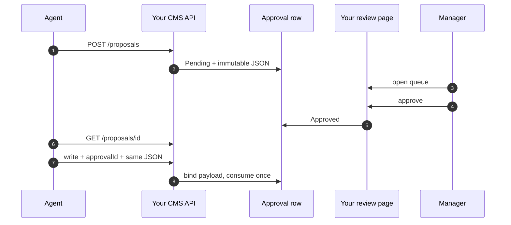
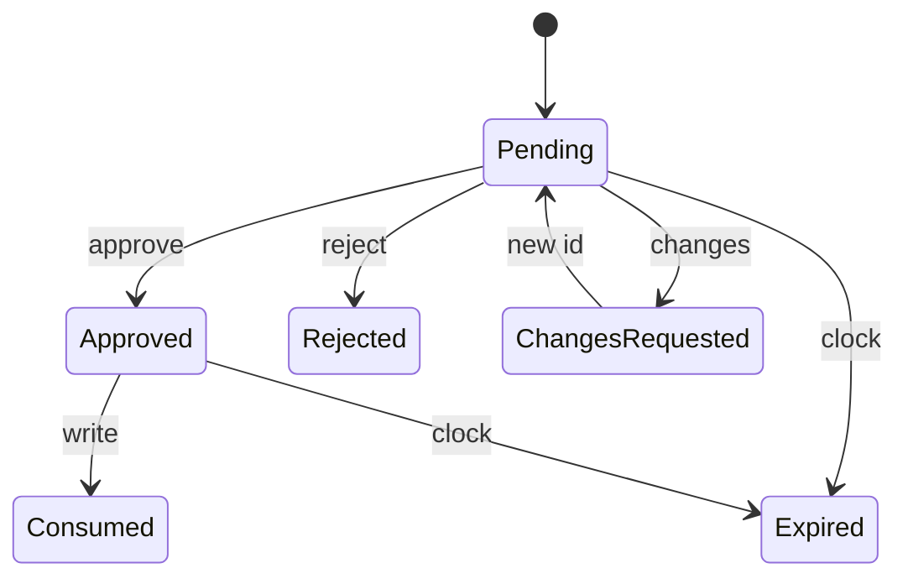

# Website Agent Connector

**English** | [فارسی](README.fa.md)

A human approval queue between an AI agent and your website's CMS.

[](LICENSE)

Connect a Hermes-style agent to any CMS you own. The agent proposes a change, a manager on your site reviews the exact
payload and decides, and the agent cannot approve itself.

This repository holds a contract, a client, a demo CMS, and a review UI. It is not a hosted product and it does not
connect to a third-party site.

It has been verified locally on a real ASP.NET WebForms stack (Web API + manager session): read, write, human approve,
one matching payload. That site is not published here. Any other stack can implement the same doors.

**[Review UI demo](demo/index.html)** · [Connect your CMS](docs/connect-your-cms.md) · [Spec](docs/spec.md) · [Architecture](docs/architecture.md) · [Security](docs/security.md)


<details>
<summary>History</summary>

</details>

<details>
<summary>Approve confirmation</summary>

</details>

## Repository layout

| Path | What to do with it |
| --- | --- |
| [`src/`](src/README.md) | The code: agent client, the agent-side receiver for decision notifications, and a modular Node server (core rules, store, CMS adapter, HTTP) |
| [`docs/spec.md`](docs/spec.md) | Contract your CMS implements |
| [`examples/`](examples/) | Agent loop, an agent that is told when you decide (`agent-webhook.mjs`), and a two-door harness |
| [`demo-cms/`](demo-cms/) | Local demo CMS: wires `src/server` to in-memory data (dummy keys, `127.0.0.1`) |
| [`demo/`](demo/) | Review UI (small ES modules under `demo/js/`) |
| [`conformance/`](conformance/README.md) | Stack-neutral test suite. Point it at any CMS URL to check that it follows the contract |
| [`ports/`](ports/README.md) | The same contract on other stacks: .NET 8 + SQL Server, a framework-free PHP core, a WordPress plugin |
| [`test/`](test/) | Unit tests for rules, service, UI helpers; HTTP end-to-end tests |

## Tested on real stacks

The contract only matters if other stacks can meet it, so the same black-box suite
([84 checks](conformance/README.md), 9 of them optional, for decision notifications) runs against each implementation on a real database. A
[differential probe](conformance/README.md#comparing-stacks-the-differential-probe) sends the same 98 hostile
requests to all of them, and a [fuzzer](conformance/README.md#fuzzing-the-stacks-against-each-other) sends thousands of
generated ones (15,000 per run of three seeds). Any disagreement is a bug in one of them.

| Stack | Database | Suite | Differential |
| --- | --- | --- | --- |
| Node reference (`src/server`, `demo-cms`) | memory | pass, notifications included (1 demo-only CORS warning) | 0 disagreements, 0 fuzz disagreements |
| [.NET 8 / ASP.NET Core](ports/dotnet/README.md) | SQL Server 2022 | 84 of 84 on the in-memory host (`ports/dotnet.tests/MemoryHost`); the SQL Server store passes every check except decision notifications, which have not been run against it yet | 0 disagreements, 0 fuzz disagreements |
| [WordPress 7.1 plugin](ports/php/wordpress/README.md) behind `php -S` | MariaDB 10.11 (InnoDB) | 83 of 84 plus 1 warning (`php -S` cannot answer the reviewer before it posts the notification, so the reviewer waits for the receiver; not a plugin fault), plus 16 WordPress-only scenarios and a browser run through wp-admin | 0 disagreements, 0 fuzz disagreements |
| WordPress 7.1 plugin behind nginx + PHP-FPM, the way most WordPress sites run | MariaDB 10.11 (InnoDB) | 84 of 84 | 0 disagreements, 0 fuzz disagreements (10,000 cases against the other three) |
| WordPress 7.1 plugin on PHP 8.3 | SQLite (SQLite Database Integration 3.0.2) | pass, plus 11 of the WordPress-only scenarios (decision notifications not yet run on this setup) | 0 disagreements, 0 fuzz disagreements |
| WordPress 7.1 plugin on [WordPress Playground](ports/php/wordpress/README.md#try-it-on-wordpress-playground-sqlite) | SQLite, PHP compiled to WebAssembly | 70 of 75, plus 2 warnings: the 3 failures are Playground's own dev server answering `500` to a malformed `%` escape. The 9 decision notification checks have not been run on Playground yet | the same cases differ |
| Symfony, Ruby on Rails | | not written yet | |

nginx and Apache refuse a malformed `%` escape (`/%zz`) with their own `400` before
WordPress runs. The suite, the probe and the fuzzer tell that apart from a CMS that reads the path before the door
([how](conformance/README.md#what-it-checks)) and say so in their output.

## Who implements what

| Side | Takes from this repo | Brings their own |
| --- | --- | --- |
| Hermes (or any agent) | [`src/client.js`](src/client.js), [agent loop](examples/agent-loop.mjs) | A write key, never the review door |
| Your CMS | [spec](docs/spec.md), state machine, guard, UI rules | Login, roles, real writes, your pages |

## Run it yourself

You need Node.js 18 or newer and nothing else: no `npm install`, no database. The demo CMS keeps its data in memory and
starts fresh every time. These steps are for Windows (PowerShell). On macOS or Linux the commands are the same.

0. Get the code: `git clone` this repository (or download the ZIP) and open a terminal in that folder.
1. Install Node.js once with `winget install OpenJS.NodeJS.LTS`, or the LTS installer from [nodejs.org](https://nodejs.org).
   Open a new PowerShell window afterwards so `node` and `npm` are found. If PowerShell answers that running scripts is
   disabled, type `npm.cmd` wherever this page says `npm`, or use Command Prompt.
2. Start the demo CMS and leave this window open (Ctrl+C stops it):

   ```powershell
   cd website-agent-connector
   npm start
   ```

3. Open the review page at <http://127.0.0.1:8790/demo/>. The line at the top says
   «متصل به دمو CMS» when the page reached the API. If it shows sample rows and «برای اتصال به API», the server is not running.
4. Run the agent in a second PowerShell window. It submits one change, prints `submitted HRM-<id> Pending`, and waits
   up to 10 minutes for a person to decide:

   ```powershell
   cd website-agent-connector
   npm run agent
   ```

5. Approve it as the manager. On the review page press «بارگذاری مجدد» (or wait for the refresh, once a minute), tick
   the new request, press «تأیید انتخاب‌شده‌ها», read the before/after table, tick the confirmation and press
   «تأیید و ثبت تصمیم». The agent window prints `executed` and exits. You can also edit the JSON before approving, and the
   agent then has to run your version. If the agent stopped waiting first, resume it with
   `$env:APPROVAL_ID=<id>; npm run agent` (and `Remove-Item Env:APPROVAL_ID` before you submit a new one).
6. Run the tests. The unit and end-to-end tests use their own ports, so the demo can keep running. The conformance
   suite checks the running demo:

   ```powershell
   npm test
   npm run conformance
   ```

| | |
| --- | --- |
| Review page | <http://127.0.0.1:8790/demo/> |
| Agent keys | `demo-read`, `demo-write` (neither can approve) |
| Review session (demo only) | `X-Review-Session: demo-manager` |
| Whole loop without a person | `npm run loop` (a test harness that approves by itself) |
| Agent that is told, not polling | `npm run agent:webhook` (see [No polling](#no-polling-tell-the-agent-when-a-person-decides)) |
| Agent that stays running and acts on the decision | `npm run agent:standing` (see [Leave an agent running](#leave-an-agent-running-that-acts-on-the-decision)) |

On WordPress, the review page is inside wp-admin. Build the plugin with `node ports/php/wordpress/build.mjs`, copy
`ports/php/wordpress/dist/hermes-approval` to `wp-content/plugins/`, activate it, and open Agent requests in the
admin menu. Setup and keys: [the plugin's README](ports/php/wordpress/README.md).

## How it works

The agent and the manager come in through different doors.

| | Agent | Manager |
| --- | --- | --- |
| Identity | Scoped API keys (read, write) | Your CMS session |
| Can do | Read, propose, poll, execute an approved write | Approve (optionally after editing the payload), reject, request changes |
| Cannot do | Approve or change the reviewed body | Hold the agent’s keys |

Once a request is Approved, the agent executes that same write once. Chat does not count as a
confirmation.




[Architecture](docs/architecture.md) · [Connect your CMS](docs/connect-your-cms.md)

## No polling: tell the agent when a person decides

By default the agent learns of a decision by asking `GET /proposals/{id}` every few seconds. A CMS can instead send a short
notification to a URL its operator configured, after each approve, reject or request-changes
([spec](docs/spec.md#decision-notifications-optional)):

```
POST https://agent.example/hooks/hermes
X-Hermes-Delivery: 5c0e...   X-Hermes-Timestamp: 1760580012   X-Hermes-Signature: sha256=8bd7...
{"event":"decision","approvalId":1042,"status":"Approved","decidedUtc":"2026-10-16T01:40:12.345Z"}
```

The notification carries only the id and the new state, never the proposal or the reason. The agent still reads the row and redeems it
with its own key, so the doors, the statuses and the write guard do not change, and a forged notification can only make the agent do
one extra `GET`. The receiver URL belongs to the site's operator, not the agent; otherwise the agent could aim the site at any address
it can reach. Delivery happens once, takes three seconds at most, is not retried and does not follow redirects. A receiver that is down, slow or
broken never changes a decision, so the agent keeps a slow poll as a fallback.

```js
const { createReceiver } = require('./src/receiver.js');     // checks the signature and the clock for you
await createReceiver({ port: 8795, secret: process.env.WEBHOOK_SECRET, onDecision: ({ approvalId }) => agent.get(approvalId) });
```

To try it, start the demo with `WEBHOOK_URL=http://127.0.0.1:8795/hook WEBHOOK_SECRET=demo-secret npm start`, run
`WEBHOOK_SECRET=demo-secret npm run agent:webhook`, and approve on the review page. The agent wakes at once. This is built into the Node
demo, the [WordPress plugin](ports/php/wordpress/README.md#telling-the-agent-when-you-decide) and the
[.NET port](ports/dotnet/README.md); a conformance group checks it on any stack.

### Leave an agent running that acts on the decision

A notification does nothing unless something is awake to receive it. An agent that lives in a chat session, or hands the waiting to a
separate watcher, can be asleep when the person decides: the notification arrives in under a second and the write still waits
for the agent to wake up. Put the action inside the receiver instead. [`src/standing-agent.js`](src/standing-agent.js) does that. It remembers the requests it filed, and when one
is approved it reads the row with its own key and redeems exactly the approved JSON (the reviewer's edit included), once. A
rejection or change request is only reported. It ignores decisions about requests it did not file, and it sweeps all open
requests at start-up and on a slow timer, so a decision made while it was down is still found.

```
BASE_URL=... WRITE_KEY=... WEBHOOK_SECRET=... STATE_FILE=standing-agent.json LOG_FILE=standing-agent.log \
  SUBMIT_FILE=requests.json npm run agent:standing        # or WATCH=14,15 for requests filed another way
```

## Rules that make review real

1. Approving is a human action. The write key cannot decide.
2. The body is bound. Resource, action, scope, and canonical JSON
   must match what the manager saw.
3. Each approval is used once. The first matching write consumes the row.
4. Failed writes roll back, and the ticket returns to Approved.
5. Revisions get new ids. Request-changes leaves the parent
   untouched.
6. Reads need no approval. `GET /resources/{type}/{id}`
   needs only the read key, while every change goes through the queue.
7. Edits are visible. If the reviewer changes the JSON, the agent must
   redeem the edited version, and History shows the original beside it.



The demo CMS uses an SEO example profile (`update:canonical`,
`/api/seo`). Your CMS can use `publish:post` or any verb that maps to
one write path.

## Contributing and security

[CONTRIBUTING.md](CONTRIBUTING.md) explains how to run the checks and what a new stack has to pass. To report a vulnerability privately, see [SECURITY.md](SECURITY.md).

## Acknowledgments

[Claude](https://claude.ai) (Anthropic) was used to help debug and test the code.

## License

[Apache License 2.0](LICENSE) © 2026 [Azhonaras](https://github.com/Azhonaras). See [NOTICE](NOTICE).
