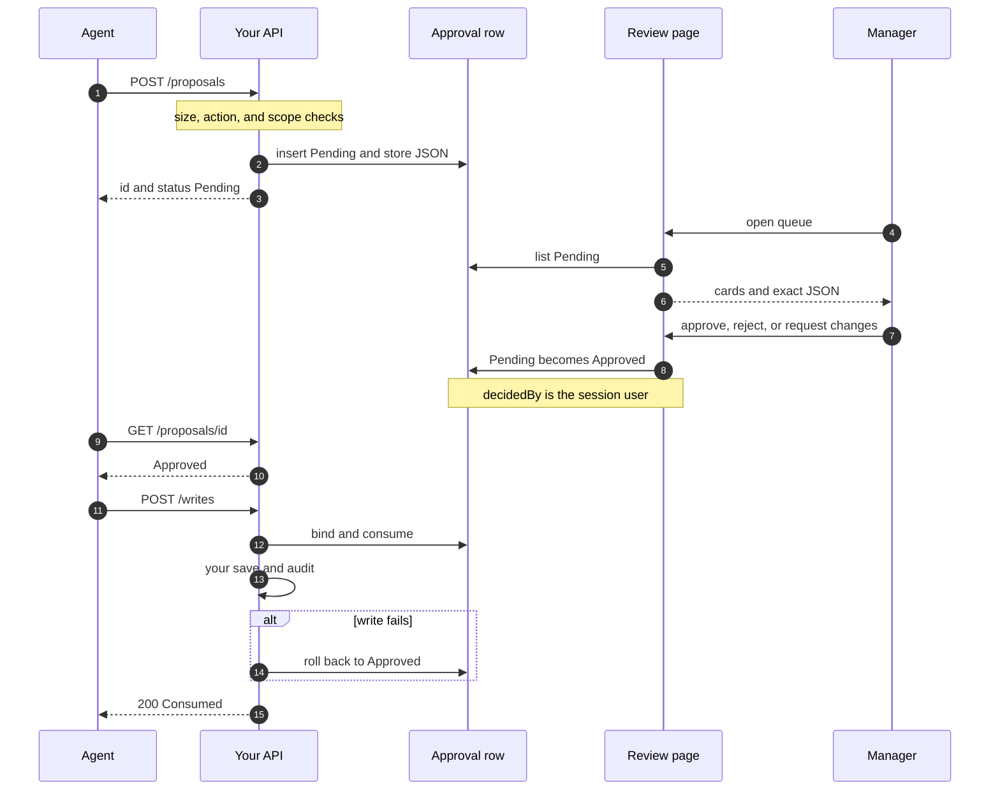
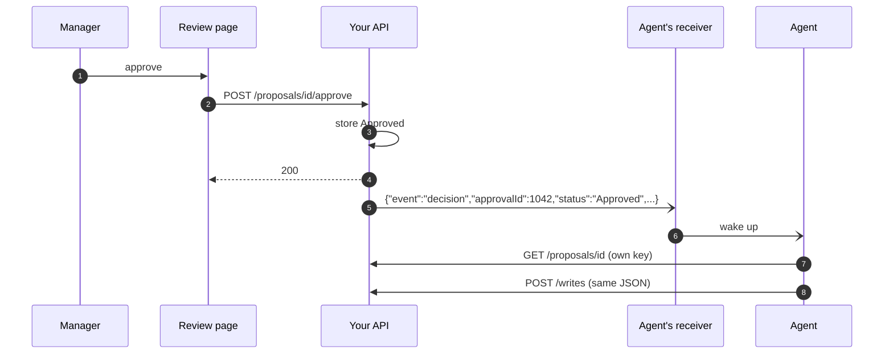
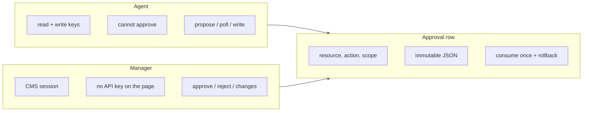
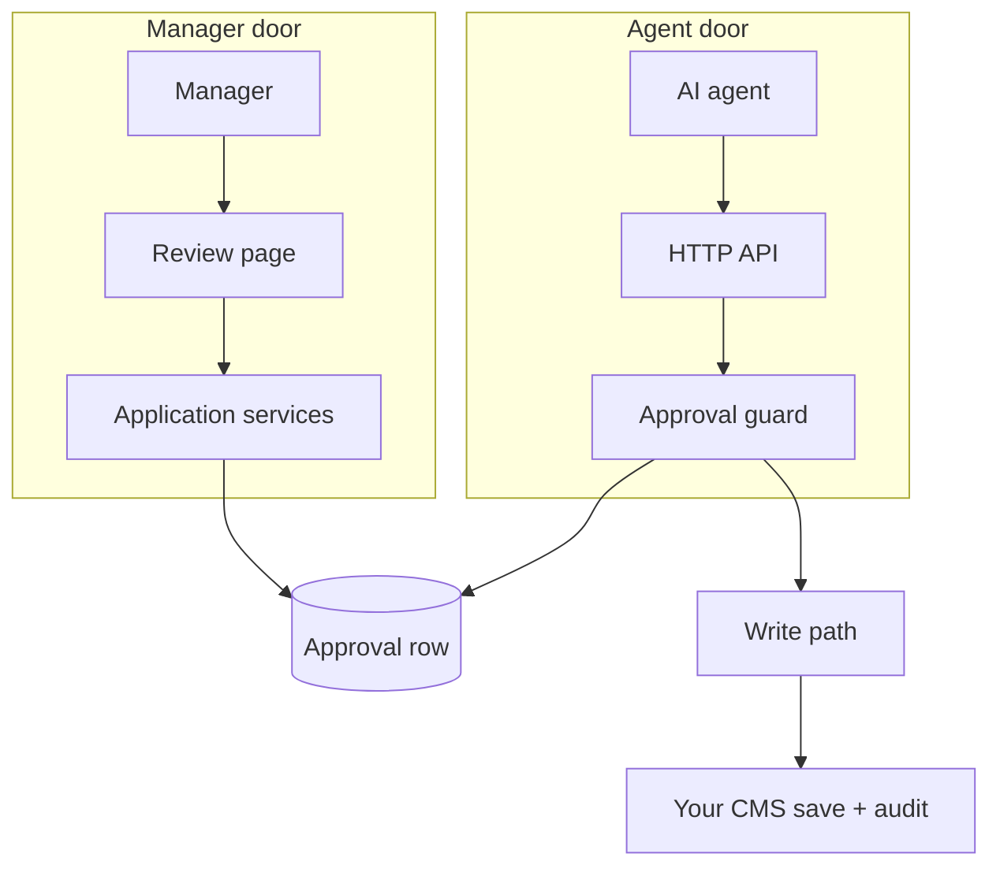
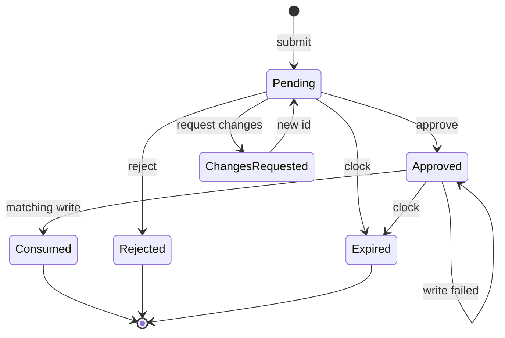
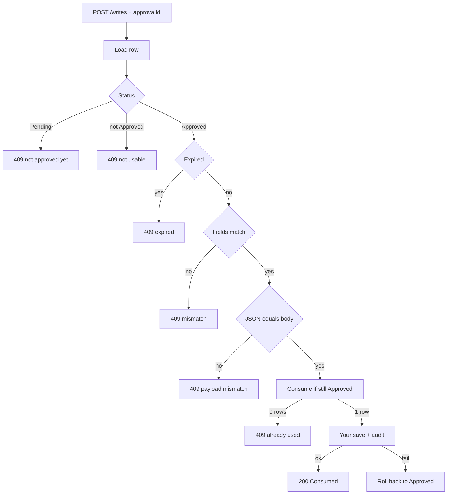

# Architecture

This document describes how an AI agent writes to your CMS without sharing the CMS login
and without being able to approve its own change. The CMS stack is yours. What this document
defines is the shared object and the guard.

The agent never opens the CMS, and the manager never holds the agent's keys.
The only shared object is the approval row: resource, action, scope,
immutable JSON, status, expiry, and who decided.

## End-to-end flow

Chat is not a step. The approve action in the CMS is the only confirmation. After
`Approved`, the agent executes that same write once.

The `GET /proposals/id` in step 11 can be triggered by a doorbell instead of a poll. A CMS may POST a four-field notification (id,
new status, time) to a receiver its operator configured, after the decision is stored and the reviewer has been answered.
The notification carries no content and no authority. The agent still reads the row and redeems it through its own key
([spec](spec.md#decision-notifications-optional)).

## Two trust domains

## Layers (you map these to your code)

| Piece | What it does |
| --- | --- |
| HTTP API | TLS, rate limit, scoped keys, proposals, writes |
| Approval guard | Status, expiry, resource match, JSON equality, consume-once |
| Application services | Submit, decide, expire pending, history |
| Store | Conditional update for decide and consume (no lost update) |
| Review page | Your login / roles, card queue, history, confirm dialogs |
| Write path | Apply approved fields through **your** CMS save, audit |

The page lives inside the CMS (same login and roles). The API can live
on the same site so there is one TLS door.

## Approval as a capability

An approval works like a capability token more than like a ticket.

- It names one resource (`article/42`), one action (`update:canonical`
  or whatever verb you defined), one scope.
- It stores the exact JSON the manager saw.
- It is minted as `Pending`, becomes `Approved` only from a human
  session, and is destroyed (`Consumed`) by the first matching write.
- A different body, even on the same resource, is `409`. The agent must
  submit a new proposal.

If the guard only checked "this id was approved for this page," the
agent could show a harmless title change and redeem a destructive
canonical. Binding the payload is what makes the review meaningful.

### Why actions are not generic

`update` is not an action. Each write path needs its own verb. Endpoints
often share a resource type, so a vague action would let one approval
unlock another endpoint.

Deletes may carry no body. The guard then binds resource + action +
scope only.

Proposals are capped (field count and serialized length) because a
human has to read them. An unreviewably large payload is refused at
submit time.

The SEO verbs in the demo CMS (`update:onpage`, `update:canonical`, …)
are an example profile. See [spec.md](spec.md).

## State machine

The parent row stays immutable. A revision is a new `Pending` id.

`Approved` is not terminal. Between the manager's click and the agent's
write, the row is waiting. History lists Rejected, Consumed, Changes
requested, Approved (waiting), and Expired, so a ticket stays visible
in that gap.

## Guard on the write path

Claim, mutation, and audit run in one transaction. Two concurrent
writes still have one winner. A failed write restores `Approved`.

## After a successful write

If your API caches read models, drop the keys the write just changed.
The agent must not read a stale cache hit as a failed write.

## Intentional non-features

- No apply-on-approve on the server. Approve records intent, and the
  agent still writes, so consume and audit stay on the same path.
- No decide key in the agent. Chat cannot approve.
- No second confirmation after the CMS click. The page is the
  confirmation.
- No content in a notification, and no agent-chosen receiver. The doorbell
  names the approval and its new state and nothing else, and only the CMS's
  operator can say where it rings.
