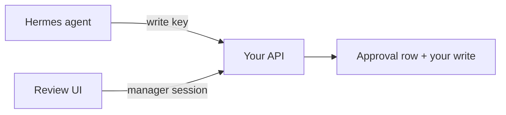

# Connect a Hermes agent to your CMS

Use this sample when you own both sides, the agent and the site. Nothing
here talks to a third-party production CMS.



## 1. Implement the contract on your stack

Copy [docs/spec.md](spec.md). Mount the routes on any base path
(`/api/approvals`, `/api/seo`, …).

Your CMS must:

1. Accept read and write API keys for the agent.
2. Keep approve, reject and request-changes on a manager session only.
   Do not give the agent a decide key.
3. Store an approval row: resource, action, scope, exact JSON, status,
   expiry, `decidedBy`.
4. On write: bind those fields, consume once, apply your existing
   save function, audit. If the save fails, return the row to
   `Approved`.
5. Use a specific action per write path (`update:title`, not `update`).

ASP.NET Core, Express, Laravel, or anything else works. The protocol
is HTTP + JSON.

Frameworks often do things that break the contract. Check these before you run the suite ([the spec](spec.md#strict-input)
has the exact rules):

* Check the door before you read the body. A framework that parses JSON, or rejects a media type, before your
  authentication runs lets an anonymous caller probe the parser.
* Route on the raw path. Do not let the framework or a proxy resolve `..`, `%2e%2e` or `\` first, and decode each
  segment once, after splitting on `/`.
* Anchor regular expressions to the end of the string (`\z`, `\A…\z`, PCRE `/D`): `$` also matches before a final newline.
* Read the key by its header name where you can. PHP under most SAPIs turns `X_Api_Key` into the same variable as `X-Api-Key`; trim spaces and tabs around the value.
* Parse JSON strictly (duplicate keys, lone surrogates, numbers beyond 2^53, nesting) and answer `415` to any
  `Content-Type` that is not `application/json`.
* Do not let a database column change what was approved. Refuse a value the column cannot hold (`siteId`) instead of
  clamping or truncating it.

On Node, you can skip the rewrite: [`src/server/`](../src/server/) is a modular
reference that you wire to your own store and CMS save code. You supply a
profile (verbs), a store, a CMS adapter (`read`, `apply`) and a reviewer
door from your login session. See [src/README.md](../src/README.md).

## 2. Point Hermes at your base URL

Give the agent only the write (and optionally read) key.

```js
var CmsApproval = require('./src/client.js');

var agent = CmsApproval.createAgentClient({
  baseUrl: 'https://cms.example.com/api/approvals',
  writeKey: process.env.CMS_WRITE_KEY
});
```

Or call the same routes with any HTTP client. The agent loop is
[examples/agent-loop.mjs](../examples/agent-loop.mjs): it submits, polls,
then executes the same JSON.

Never put the review session or manager cookie in Hermes.

Optionally, tell the agent instead of making it poll. Have your CMS post a short notification to a URL that you, the
operator, configure (never one the agent can choose) after each approve, reject or request-changes. The body is just
`{"event":"decision","approvalId":1042,"status":"Approved","decidedUtc":"..."}`, signed with a shared secret; the agent still reads
the row and redeems it with its own key. Send it after you have answered the reviewer (or in the background), once, with a
3 second time-out, no retry, redirects not followed, and let no failure of the receiver change the decision. The exact rules and a
test vector for the signature are in [the spec](spec.md#decision-notifications-optional); the agent's side is
[`src/receiver.js`](../src/receiver.js) and [`examples/agent-webhook.mjs`](../examples/agent-webhook.mjs); the conformance suite
checks your side with `notify` in the profile.

## 3. Prove it with the conformance suite

Point [`conformance/`](../conformance/README.md) at your staging URL. It checks
the doors, the payload binding, consume-once, races and (optionally) the real
CMS state, and lists the manual checks no script can do.

## 4. Build or reuse a review page

The [demo](../demo/index.html) is a starting UI. Put the real page
behind your CMS login. Before they decide, managers see the resource, action,
reason, the exact payload, and what the resource holds now.

To reuse the page as it is, serve `demo/` (with `src/client.js` beside it) from a page only reviewers can open, and tell
it where the API is and how the reviewer signs in before `js/main.js` loads:

```html
<script>
  window.HermesQueue = {
    apiBase: 'https://cms.example.com/api/approvals',
    headers: { 'X-CSRF-Token': '…' },   // your CMS's anti-forgery header; the login cookie goes along by itself
    cmsHome: '/admin/'                  // where "back to CMS" leads
  };
</script>
```

The page may also run in a same-origin frame whose parent sets `window.HermesQueue`. The WordPress plugin does
this ([`AdminPage.php`](../ports/php/wordpress/hermes-approval/src/AdminPage.php)). `createReviewClient` refuses headers
that carry an agent key.

Treat everything the agent wrote as hostile on this page: the reason, the JSON, resource names. Escape it before it
goes into HTML. A review page that renders agent text as HTML lets the agent run script with the manager's session and
approve its own requests.

## 5. Try it without a site first

```bash
npm start          # then open http://127.0.0.1:8790/demo/
npm run agent      # in a second terminal: submits a change and waits for you to approve it on that page
npm test
```

Step by step, on Windows too: [Run it yourself](../README.md#run-it-yourself).

The process in `demo-cms/` is a demo CMS. Replace it with your
implementation when the loop looks right. Dummy keys (`demo-read`,
`demo-write`, `demo-manager`) work only there.

## What you do not copy

- Someone else's database, hosts, or keys
- A requirement to use Node or ASP.NET in production
- The SEO action list, unless your site is that kind of CMS
