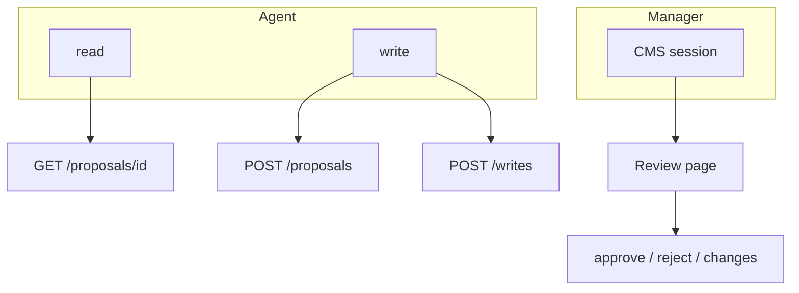

# Security

How the review page lets an agent reach your CMS without the privilege to
skip the human.

The demo CMS in this repo binds `127.0.0.1`, uses dummy keys, and
sends `Access-Control-Allow-Origin: *` so the local UI can call it.
Do not copy that CORS setting or those keys onto a public host.

## Threats and controls

| Threat | What would go wrong | Control |
| --- | --- | --- |
| Agent approves itself | Prompt or tool loop clicks "yes" | Decide exists only on the CMS session |
| Agent approves itself through the page | Agent-written text (reason, JSON) rendered as HTML runs script with the manager's session and calls approve | The review page escapes every agent-written string; unit tests render the cards and the approve dialog with a hostile reason |
| Approved, but not what ran | The CMS's save function alters the value (WordPress strips backslashes) | Pass values the way the save function expects them; a real-CMS scenario checks the stored value equals the approved one |
| Harmless proposal, hostile write | Approve a title, redeem a redirect | Payload binding: canonical JSON must match |
| Replay a captured decide POST | Steal a manager's click | Bind decide to this session (anti-forgery / request tickets) |
| Two writers, one approval | Double apply | Conditional consume, one row affected |
| Failed write after consume | Ticket gone, content unchanged | Claim + write + audit in one transaction |
| Key leak from the page | Browser holds write/decide | Page uses session only; no API key in HTML or JS |
| Scope confusion | Read key used to write | Submit and mutate check scopes first |
| Unreadable proposal | Hide the dangerous field in noise | Field-count and byte-size caps at submit |
| Stale "it didn't write" | Agent retries or escalates | Drop the read cache you just changed |
| Broken Unicode | Non-ASCII stored as `?` | UTF-8 JSON body, never a shell argument |
| Two readers of one request | A proxy, WAF or second parser sees a different path or body than the one that was approved | Route on the raw path (nothing normalised), decode once, strict JSON (duplicate keys, lone surrogates, huge numbers refused), one `Content-Type` |
| Probing the parser | An anonymous caller learns how bodies are read from the error | The door answers first (`401`/`403`), before the path, the media type or the body is looked at |
| A column changes the value | A number is clamped or truncated on its way into the database, so the row no longer says what was approved | Values the column cannot hold are refused (`siteId` 1 to 999,999,999), never coerced |
| The agent aims the CMS at an address (SSRF) | If the agent could choose where decision notifications go, it could make the CMS call any host on the CMS's network | The receiver URL is set only by the CMS operator (`wp-config.php`, an environment variable); there is no field for it in any request. It must be plain `http(s)` without credentials, and redirects are not followed |
| A notification leaks content | The receiver may be a third-party service, a log, a proxy | The body is the approval id, the new status and the time, nothing else: no proposal, reason, resource or reviewer. The conformance suite proves that with a distinctive proposal and reason |
| A forged or replayed notification | Someone posts "approved" to the agent's receiver, or replays an old one | A nudge only makes the agent do one more `GET` with its own key, so a forgery cannot approve or change anything. With a secret, the receiver verifies an HMAC over the raw body and a timestamp within five minutes, in constant time; without one it must treat the nudge as a hint |
| A broken receiver stops the reviewer | The agent's server is down or slow, so approving hangs or fails | A failed, slow or `500` receiver never changes the decision (a `MUST`, checked); delivery is once, three seconds at most, no retry, after the reviewer has been answered where the platform allows |

## Two authenticators

```
read   ──►  agent     inventory, poll
write  ──►  agent     propose + redeem
decide ──►  manager   your CMS session only
```



The agent cannot pass `decidedBy`. The page only allows ids it rendered
for that manager. Hidden fields carry ids + action + reason; the server
parses them and checks membership in the rendered set.

## Telling the agent without trusting the message

A decision notification carries no authority. The agent still asks the CMS, through its own key, what the
row says, and redeems the exact approved JSON through the same guard. The worst a forged, replayed, reordered or lost
notification can do is cost the agent one extra read, or make it fall back to its slow poll. The signature stops
strangers from making the agent waste work; the approval does not depend on it. The secret lives only in the CMS operator's
configuration and in the agent's receiver. It is never in a request body, a response or the review page.

## Payload binding

`RequireBound(approvalId, resource, action, scope, body)`:

1. Load the row.
2. Refuse `Pending`, anything other than `Approved`, and expired rows.
3. Compare resource / action / scope / id.
4. Canonicalize stored JSON and request JSON (stable key order; strip
   `approvalId` from both sides).
5. If they differ: payload mismatch.
6. Consume only while `Status = Approved`.
7. Zero rows → already used.

Deletes have no body. Those bind resource + action + scope only.

Canonicalization does no I/O, so a harness can drive the rules without a
database.

## Encoding

If the agent puts non-ASCII text in a shell argument, the bytes that
arrive are often ASCII `?`. The manager then approves question marks,
and the guard writes question marks. To avoid this, send the JSON as a
UTF-8 file body. The review page is UTF-8, so what the manager sees is
what was stored.
